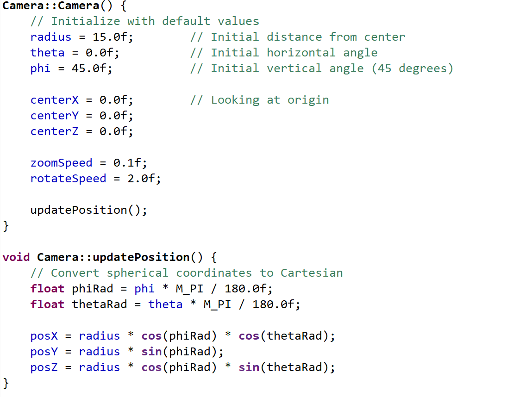
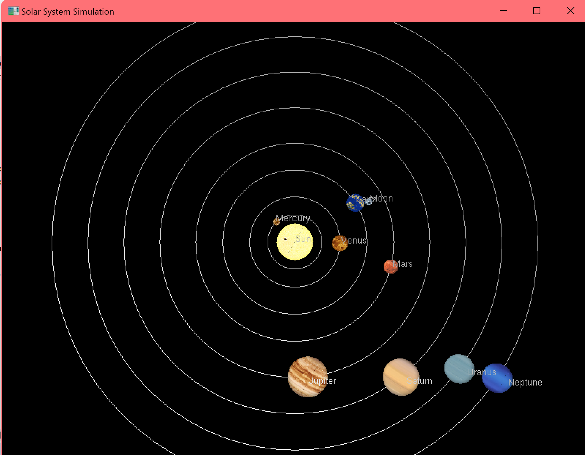
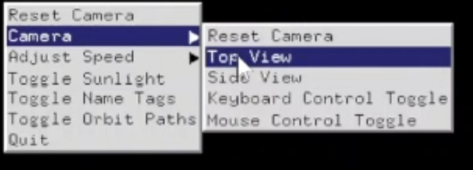
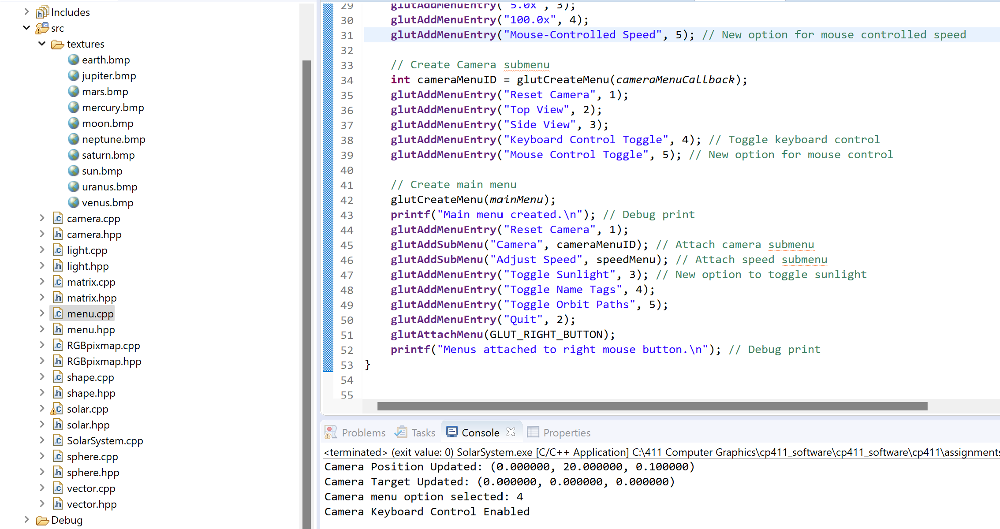

# PROJECT Report

**Authors and Student ID**: 
- Dylan Atkinson
- Basleal ABshiro
- Omar Abdeen
Date: 11/22/2024

Check [readme.txt](readme.txt) for course work statement and self-evaluation. 
  

## R1 Proposal (proposal)

### R1.1 Application problem description
 

Complete? (Yes) 

Include the proposal in submission package and add link to the proposal. 

	

### R1.2 Creativity/new features
 

Complete? (Yes) 

Add a few words to high light.

Added realistic sunlight toggle feature
Added interactive speed manipulation
Added All-Around camera movement
Used bitmap files for realistic orbital body textures and looks
Added preset features for the camera and the simulation speed
Toggle options for orbit path view

### R1.3 Design consideration
 

Complete? (Yes) 

see proposal

### R1.4 Milestones and schedule
 

Complete? (Yes) 

see proposal

### R1.5 References
 

Complete? (Yes) 

see proposal

### R1.6 Writing of the proposal
 

Complete? (Yes) 

see proposal

## R2 Design & implementation (programming)

### R2.1 Problem solving and algorithms
 

Complete? (Yes) 

If Yes, insert a screen shot image to show the completion.

### R2.2 Completion of the project
 

Complete? (Yes/No) 

If Yes, insert a screen shot image to show the completion.

### R2.3 New features
 

Complete? (Yes/No) 

If Yes, insert a screen shot image to show the completion.

### R2.4 Program design and organization
 

Complete? (Yes) 

If Yes, insert a screen shot image to show the completion.

## R3 Delivery (document)

### R3.1 Presentation & demonstration
 

Complete? (Yes) 

If not presented in class, include media file, and add link to the medial file.

### R3.2 Documentation
 

Complete? (Yes) 

Add the hyperlinks to the documents. 

	

### R3.3 Submission packaging
 

Complete? (Yes) 

This package.

**References**

1. CP411 project
2. Add your references if you used any. 
